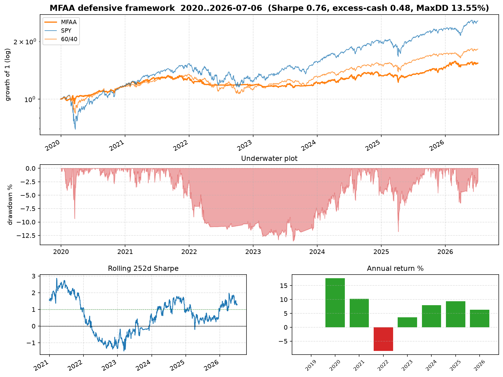

# MFAA — Multi-Factor Adaptive Allocation

[](https://github.com/xzliuxz/MFAA-defensive-multi-asset-framework-/actions/workflows/ci.yml)
[](https://www.python.org/)
[](LICENSE)

**A defensive, multi-asset allocation framework with an honest, anti-overfitting
research harness.**

MFAA is a long-only, monthly, price-only ETF strategy built from published factors
— cross-sectional "13612" momentum, ensembled trend following, a breadth "canary"
crash overlay, inverse-volatility weighting and volatility targeting. Almost all of
it was published *before 2020*; the exception is that the canary overlay and the
defensive pool also draw on Keller's 2022 BAA paper (see the
[caveats](docs/methodology.md#known-residual-caveats)). It is designed to be a **defensive sleeve / diversifier**:
roughly half the volatility and drawdown of equities, low beta, and strong
behaviour in crises — not a return- or Sharpe-maximiser.

What makes this repo unusual is not the strategy but the **discipline around it**:
no parameter is tuned on the evaluation period, selection is refused in favour of
a fixed neutral prior, and every headline ships with a Deflated Sharpe Ratio,
bootstrap confidence interval, crisis table and full sensitivity grid so you can
see exactly how much to trust it.

## Out-of-sample performance (2020-01 → 2026-07, after 10 bps costs)

Fixed neutral-prior configuration, evaluated **once** on a period never used to tune it.
Two components follow a paper published in 2022, so this is not strictly
out-of-sample (see the caveats):

| Metric | **MFAA** | SPY | 60/40 |
|--------|---------:|----:|------:|
| Sharpe (excess over cash) | 0.48 | 0.69 | 0.60 |
| CAGR | 6.9% | 15.6% | 9.7% |
| **Max drawdown** | **13.6%** | 33.7% | 21.0% |
| Annualised vol | **9.3%** | 20.3% | 12.3% |
| Ulcer index | **6.5** | 8.4 | 7.0 |
| Beta to SPY | **0.17** | 1.00 | 0.59 |

**Crisis drawdowns (peak-to-trough) — where a defensive book earns its keep:**

| Episode | **MFAA** | SPY | 60/40 |
|---------|---------:|----:|------:|
| COVID crash (Feb–Mar 2020) | **+0.8%** | −33.7% | −19.1% |
| 2022 bear (stocks + bonds) | **−7.9%** | −24.5% | −20.5% |
| 2025 tariff shock | −10.2% | −18.8% | −10.6% |



> **Honest framing (please read).** MFAA is **not** a Sharpe-maximiser — its
> excess-over-cash Sharpe (0.48) is *below* a naive 60/40. Its edge is **tail
> risk and low correlation**: about ⅖ of SPY's drawdown, the lowest Ulcer index
> of the three, beta 0.17, and near-flat through the COVID crash. Its alpha vs
> SPY is positive but not statistically significant on 6.5 years (t≈1.3). Use it
> as a **defensive overlay/diversifier**, not a standalone growth engine. See
> [docs/methodology.md](docs/methodology.md) for the full protocol, caveats, and
> the statistical read-out (bootstrap CI, Deflated Sharpe).

## Why you can trust the number

Most backtests you find are in-sample fits. This one is built the other way:

- **No parameter tuned on 2020→now.** Every lookback and threshold comes from
  published research — pre-2020, except the BAA (2022) elements of the canary
  overlay and the defensive pool.
- **Ensembling instead of magic numbers.** Trend averages over {6,10,12}-month
  SMAs; volatility over {21,63,126} days. Sensitivity analysis shows swapping the
  ensemble for any single lookback barely moves the result.
- **No cherry-picked variant.** The config is a fixed *neutral prior* (equal
  sleeve blend, graded canary, half-universe breadth). An 18-cell grid is shown
  on both the design and evaluation periods only to prove the prior sits mid-pack.
- **Deflated Sharpe Ratio** (Bailey & López de Prado 2014) with the honest trial
  count, plus a stationary block-bootstrap 95% Sharpe CI.
- **Mechanical anti-fraud tests.** A constant-price backtest must never gain
  value (blocks synthetic-return injection); point-in-time tests prove future
  data cannot change past weights.

## Installation

```bash
pip install -e ".[yfinance]"     # engine + data download
# without yfinance (bring your own price CSV): pip install -e .
```

## Quick start

```bash
# Full research protocol: robustness grid -> single OOS run -> sensitivity ->
# bootstrap + Deflated Sharpe -> crisis table -> tearsheet. Caches prices to data/.
python scripts/run_experiment.py           # from a fresh clone (no install needed)
mfaa-experiment                            # after pip install -e .
python -m mfaa                             # equivalent

# Re-download prices (14 ETFs, 2004->now via yfinance)
python scripts/run_experiment.py --refresh
```

Outputs land in `results/multifactor/`: `metrics.json`, `tearsheet.png`,
`crisis_table.csv`, `design_grid.csv`, `oos_grid.csv`, `sensitivity.csv`,
`weights.csv`.

## Python API

```python
from mfaa import run_multifactor_backtest, load_universe_prices, analytics

prices = load_universe_prices()          # cached daily adjusted closes
res = run_multifactor_backtest(prices, start_date="2019-12-15")

equity = res["equity"]
metrics = analytics.full_metrics(
    equity, cash_prices=prices["BIL"], benchmark_prices=prices["SPY"], label="MFAA"
)
print(metrics["sharpe_excess_cash"], metrics["max_drawdown_pct"])

# institutional tearsheet + crisis table
analytics.tearsheet(equity, {"SPY": prices["SPY"]}, "tearsheet.png")
analytics.crisis_table({"MFAA": equity, "SPY": prices["SPY"]})
```

## Strategy architecture

**Universe (fixed ex-ante, all inception ≤ mid-2007):**
risky {SPY, QQQ, IWM, EFA, EEM, VNQ, TLT, LQD, GLD, DBC}; defensive {IEF, TIP,
BIL}; canary {SPY, EFA, EEM, AGG}.

| Sleeve | Rule | Literature |
|--------|------|------------|
| **XSMOM** | Top-N by mean of 1/3/6/12m returns, gated vs cash momentum, blended inverse-vol weights | Jegadeesh–Titman 1993; Antonacci 2014; Keller–Keuning 2016 |
| **TSTREND** | Inverse-vol budget × fraction of the {6,10,12}m SMA ensemble the asset is above | Faber 2007; Moskowitz–Ooi–Pedersen 2012 |
| **Canary** | Breadth of fast 13612W momentum across {SPY,EFA,EEM,AGG} de-risks the whole book | Keller–Keuning 2017/2022 (VAA/BAA) |
| **Vol target** | Scale to 10% realised vol, cap 1.5× | Moreira–Muir 2017 |

Signals are computed on month-end closes; positions apply from the **next** trading
day. Proportional transaction costs on turnover + financing on gross exposure > 1.

## Project structure

```
src/mfaa/
├── multifactor.py   # engine, backtest, bootstrap, Deflated Sharpe
├── analytics.py     # excess-cash Sharpe, Ulcer, IR, crisis table, tearsheet
├── experiment.py    # the full anti-overfitting protocol (mfaa-experiment)
└── __main__.py      # python -m mfaa
scripts/run_experiment.py        # no-install entry point
docs/methodology.md              # protocol, literature sources, honest results
tests/test_mfaa.py               # 20 tests (point-in-time, accounting, analytics)
```

## Development

```bash
pip install -e ".[dev]"
ruff check src tests scripts
pytest -q
```

## Limitations

- **~6.5 years OOS ≈ 78 monthly bets** — small sample; the bootstrap CI is wide.
- **Monthly rebalance** absorbs intramonth crashes until the next signal date.
- **Cost model** is linear turnover + financing; no market impact or borrow.
- The strategy is a **defensive diversifier**, judged on drawdown/beta/crisis
  behaviour — not a benchmark-beating total-return engine.

**For research and educational purposes only. Not financial advice.**

## License

MIT
